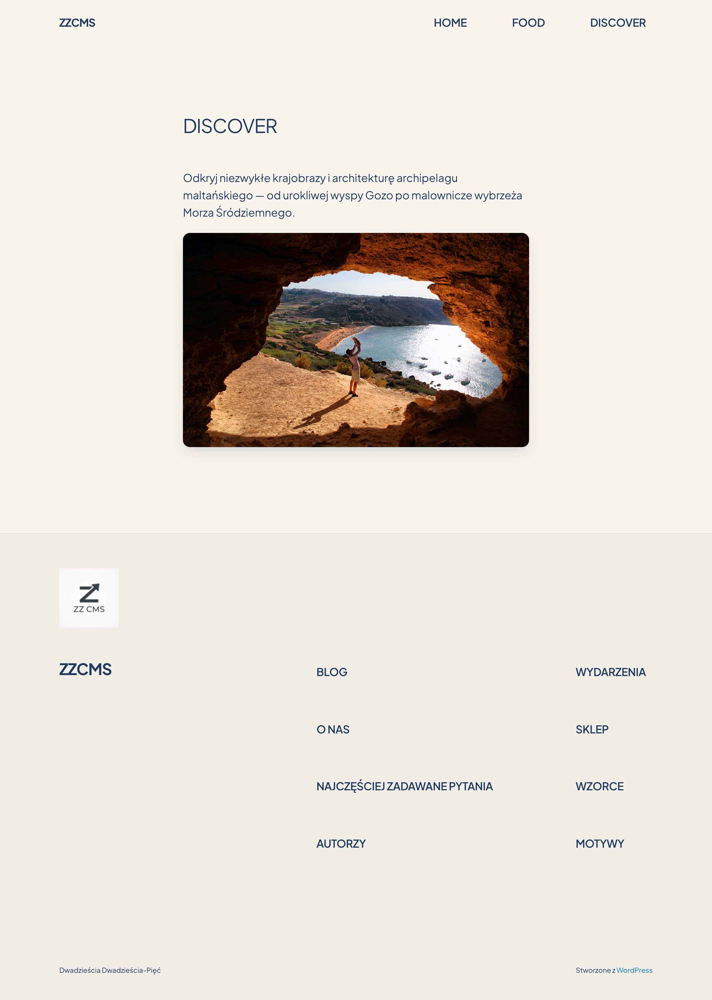

# Zajęcia CMS – Zdjęcia Strony

Repozytorium zawiera zrzuty ekranu lokalnej witryny WordPress zbudowanej w Dockerze na macOS, dokumentującej zajęcia z przedmiotu CMS.

## Motyw

Własny motyw potomny (child theme) **Strona** oparty na Twenty Twenty-Five:
- Paleta barw inspirowana Maltą (Warm Limestone, Deep Navy, Mediterranean Blue, Golden Sand…)
- Czcionka: **Plus Jakarta Sans**
- Blog: lista czystych linków bez miniatur i dat
- Każda strona zajęć: 3 ilustracje SVG

---

## Podstrony

| Plik | Opis | URL (lokalnie) |
|------|------|----------------|
| `01-strona-glowna.png` | Strona główna – lista zajęć | `http://localhost/` |
| `02-zajecia-01.png` | Zajęcia 01 – Środowisko serwerowe i instalacja WordPressa | `http://localhost/2026/10/16/zajecia-01-…/` |
| `03-zajecia-02.png` | Zajęcia 02 – Motywy, style i projektowanie stron w WordPressie | `http://localhost/2026/10/23/zajecia-02-…/` |
| `04-podstrona-home.png` | Podstrona HOME – mapa Malty | `http://localhost/home/` |
| `05-podstrona-food.png` | Podstrona FOOD – Pastizzi | `http://localhost/food/` |
| `06-podstrona-discover.png` | Podstrona DISCOVER – Gozo | `http://localhost/discover/` |

---

## Screenshoty

### 01 – Strona główna

### 02 – Zajęcia 01

### 03 – Zajęcia 02

### 04 – HOME

### 05 – FOOD

### 06 – DISCOVER

---

## Stack

- **CMS**: WordPress (latest) w kontenerze Docker
- **Baza danych**: MariaDB (latest)
- **System**: macOS / Docker Desktop
- **Screenshoty**: Playwright (Chromium, 1440 × 900 @2×, fullPage)
