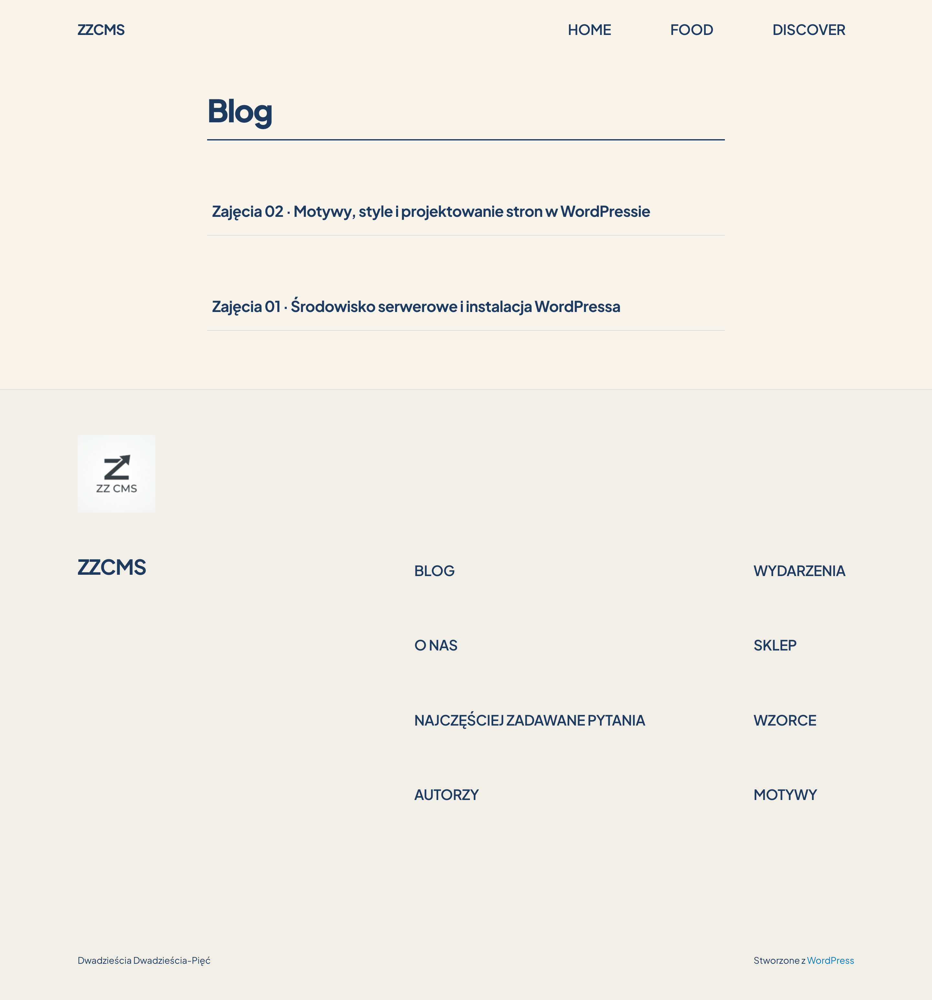
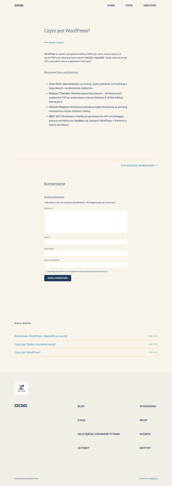
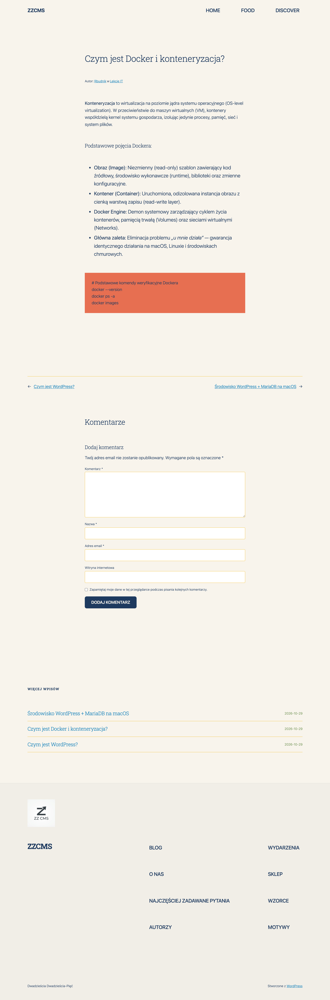
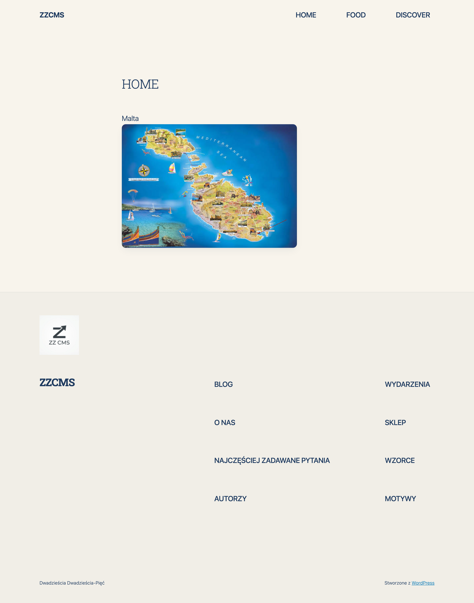
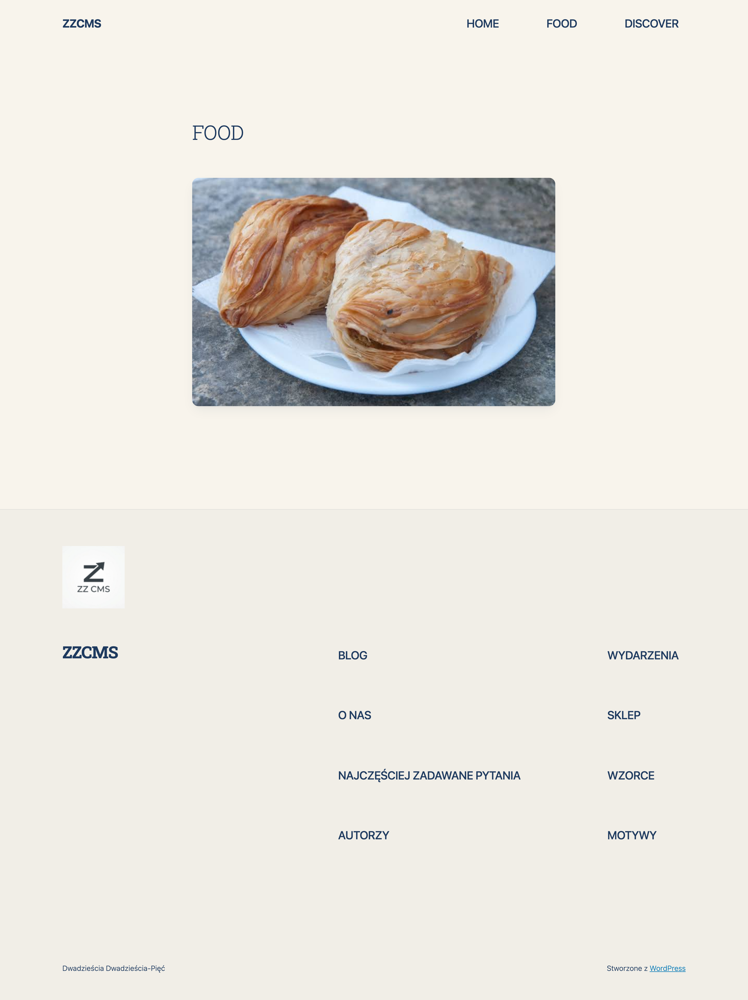

# zajecia cms zdjecia strony

Dokumentacja wizualna oraz zrzuty ekranu (full-page) lokalnego serwisu WordPress uruchomionego w środowisku Docker (MariaDB + WordPress) na systemie macOS.

---

## 📸 Galeria Zrzutów Ekranu

### 1. Strona Główna (Lista wpisów / Lekcje IT)
*Przegląd wpisów blogowych z wdrożoną paletą barw Malty i nową typografią.*

---

### 2. Wpis: Czym jest WordPress?
*Artykuł omawiający architekturę CMS, silnik Core, motywy, wtyczki oraz REST API.*

---

### 3. Wpis: Czym jest Docker i konteneryzacja?
*Podstawy wirtualizacji na poziomie kernela, definicje obrazu, kontenera oraz Docker Engine.*

---

### 4. Wpis: Środowisko WordPress + MariaDB na macOS
*Praktyczna konfiguracja pliku docker-compose.yml i uruchomienie bazy MariaDB oraz WordPressa na macOS.*

---

### 5. Podstrona: HOME (Malta)
*Widok podstrony wprowadzającej z mapą Malty.*

---

### 6. Podstrona: FOOD (Pastizzi)
*Kulinaria i tradycyjne maltańskie pastizzi w stylizowanym kontenerze.*

---

### 7. Podstrona: DISCOVER (Gozo & Gnejna)
*Miejsca i atrakcje archipelagu maltańskiego.*

---

## 🛠️ Specyfikacja Środowiska Lokalnego

| Komponent | Wersja / Narzędzie | Rola |
| :--- | :--- | :--- |
| **Silnik wirtualizacji** | Docker Desktop (macOS) | Konteneryzacja stosu technologicznego |
| **Baza danych** | MariaDB | Przechowywanie danych WordPressa |
| **CMS** | WordPress 6.7+ | Serwer aplikacji i generator treści |
| **Motyw** | `strona` (child theme Twenty Twenty-Five) | Szablon blokowy FSE z dedykowaną paletą Malty |
| **Adres lokalny** | `http://localhost` | Port 80 (mapowany z kontenera) |

---
*Repozytorium utworzone automatycznie: zajecia cms zdjecia strony.*
